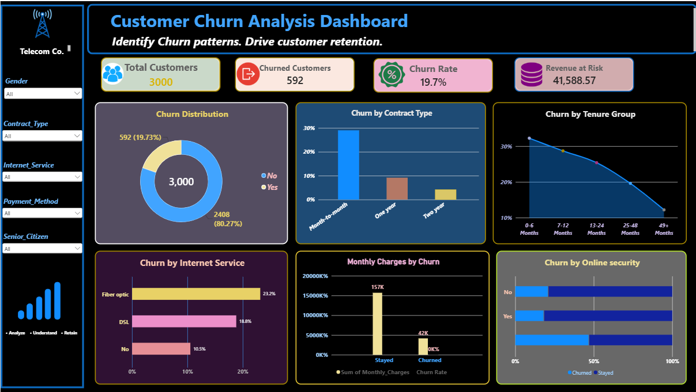

## Customer Churn Analysis Dashboard | Power BI

## Project Overview

The Customer Churn Analysis Dashboard is a data analytics project developed using Microsoft Power BI. The main objective is to analyze customer behavior, identify customers who are leaving the company, and understand the factors affecting customer churn.

The dashboard provides interactive visualizations and key performance indicators (KPIs) to help businesses monitor customer retention and make data-driven decisions.

## Objectives

- Analyze customer churn rate and customer retention.
- Identify churn patterns based on contract type.
- Understand the relationship between customer tenure and churn.
- Analyze churn based on internet service and online security.
- Compare monthly charges between churned and retained customers.
- Identify important factors that influence customer churn.

## Tools & Technologies Used

- Microsoft Excel – Data cleaning and preprocessing.
- Power BI – Dashboard development and data visualization.
- DAX – Creating calculated measures and columns.
- Power Query – Data transformation.

## Dashboard Features

- Total Customers
- Churned Customers
- Churn Rate
- Revenue at Risk
- Churn Distribution
- Churn by Contract Type
- Churn by Tenure Group
- Churn by Internet Service
- Churn by Online Security
- Average Monthly Charges by Churn

## Key Insights

- Monitor the percentage of customers leaving the company.
- Identify contract types with higher customer churn.
- Understand how customer tenure affects churn.
- Compare customer churn across different internet services.
- Analyze differences in monthly charges between churned and retained customers.

## Project Workflow

1. Collected the customer churn dataset.
2. Cleaned and prepared the data using Excel.
3. Imported the dataset into Power BI.
4. Created DAX measures and calculated columns.
5. Designed interactive charts, KPI cards, and slicers.
6. Analyzed customer churn patterns and generated insights.

## Skills Gained

- Data Cleaning
- Data Analysis
- Data Visualization
- Power BI Dashboard Development
- DAX Calculations
- Business Intelligence
- Analytical Thinking

## Dashboard Preview

Conclusion

This project helps understand customer churn patterns and identify factors that influence customer retention. The interactive Power BI dashboard transforms raw customer data into meaningful insights that can support better business decisions and customer retention strategies.

Author

Vidavalapati Hemanth

Domain: Data Analytics
Tool: Microsoft Power BI
